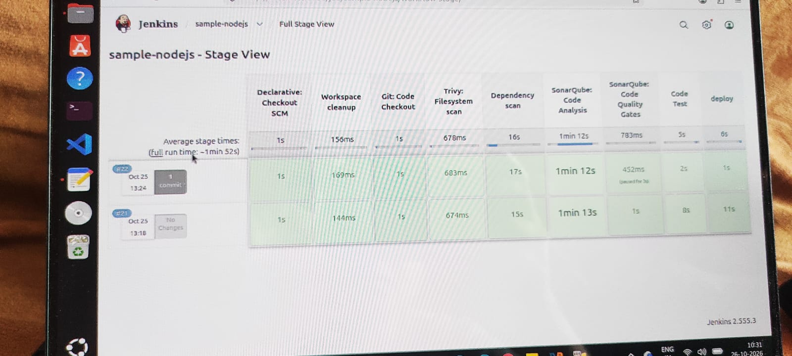

# Jenkins CI-CD

A hands-on repo to learn Jenkins CI/CD from scratch.

## What's Inside

This repo contains a **Flask web app** with a full **CI/CD + DevSecOps pipeline** built entirely on Jenkins

```
app.py                  → Flask app (source code)
Dockerfile              → Container image definition
docker-compose.yml      → Production deployment config
templates/index.html    → App frontend
requirements.txt        → Python dependencies (flask, flake8, bandit, gunicorn, pytest)
test_app.py             → Route tests (pytest)
Jenkinsfile             → Pipeline config
```

###  DevSecOps Pipeline

A production-grade security pipeline. Triggered on push to `main`.

```
push to main
    ├── Code Quality ──── flake8 + bandit SAST (matrix: 3.11–3.13)
    ├── Dependency Scan ─ pip-audit (package CVEs)
    ├── Docker Lint ───── Trivy scan (Dockerfile best practices)
    ├── Sonarqube scan ───── SAST
    └── Tests ─────────── pytest (route tests)
    └── Deploy to Server ───── docker compose up
```

| # | Stages | What It Does |
|---|---------|-----------------|
| * | [DevSecOps Pipeline]
| 1 | [Dependency Scan], `pip-audit`, vulnerability databases | Audits Python packages for known CVEs |
| 2 | [Docker Lint] | Validates Dockerfile against best practices |
| 3 | [Sonarqube scan] | SAST for code |
| 4 | [Tests] `pytest`, Flask test client | Runs pytest against Flask routes (/, /health) |
| 5 | [Deploy to Server] | Runs docker-compose, deploys the app |


The successful deployment on push to main branch is as below


